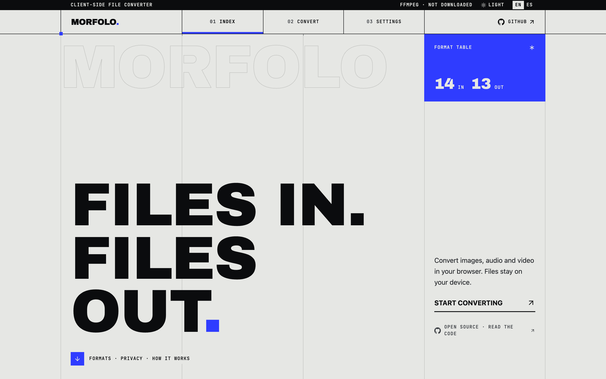
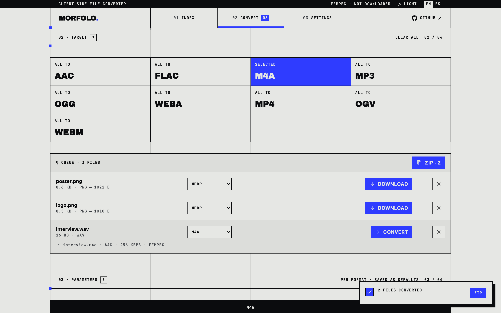
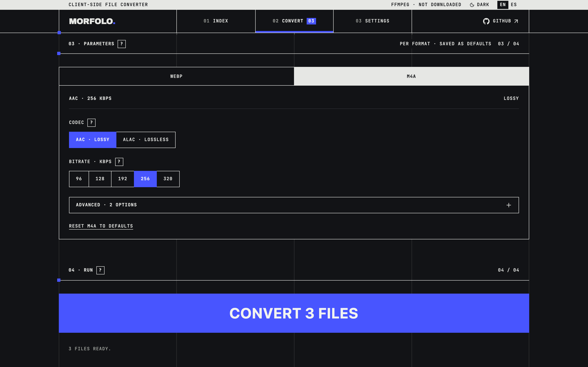
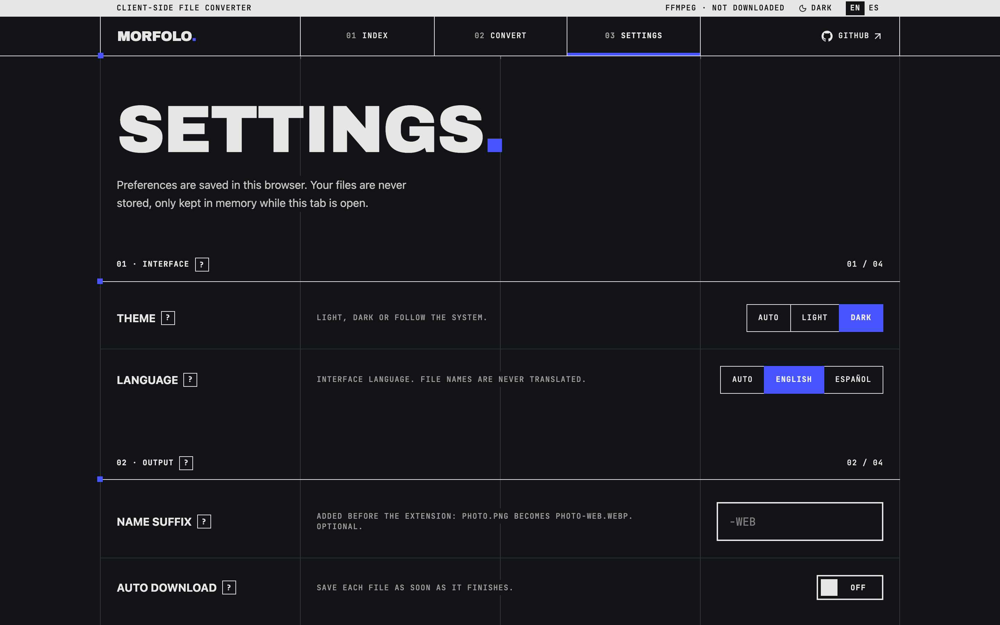
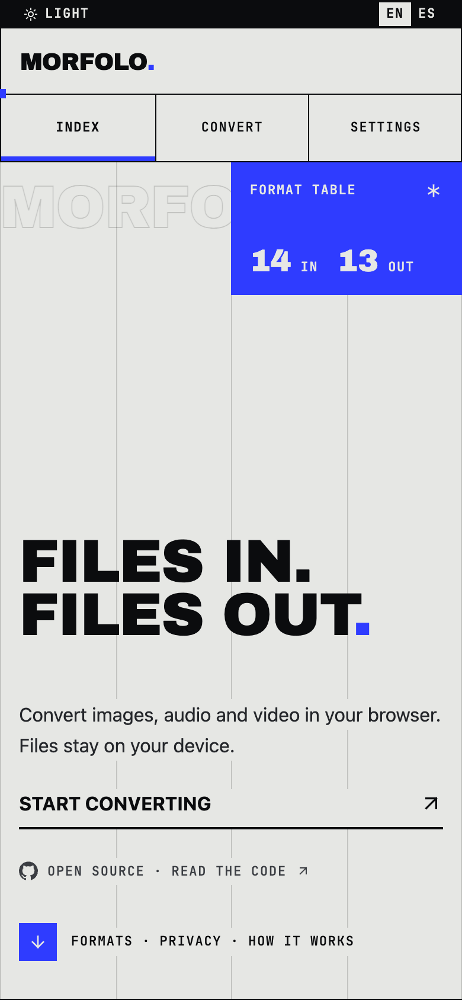

# Morfolo

**Convert images, audio and video in your browser. Files stay on your device.**

[morfolo.andesvel.workers.dev](https://morfolo.andesvel.workers.dev) · [`@morfolo/core` on npm](https://www.npmjs.com/package/@morfolo/core) · [Issues](https://github.com/andesvel/morfolo/issues)

<picture>
  <source media="(prefers-color-scheme: dark)" srcset="docs/screenshots/landing-dark.png">
  
</picture>

Morfolo is a file converter that runs entirely client-side. Nothing is uploaded: images are converted with the Canvas API in a Web Worker, audio and video with ffmpeg compiled to WebAssembly, all inside the tab. The only download is the ffmpeg engine itself, fetched once from a CDN and cached.

This repository holds two things:

- **The web app**: a single-page tool with a brutalist interface on a Swiss grid.
- **`@morfolo/core`**: the conversion engine as a framework-agnostic npm package you can use in your own app.

## Features

**Conversion**
- Images: PNG, JPG, WEBP, BMP in; PNG, JPG, WEBP out. Quality, resize and a transparency fill for JPG.
- Audio: MP3, WAV, FLAC, OGG, AAC, M4A, WEBA in and out. Codec choice where the container allows it (AAC or lossless ALAC in M4A, Opus or Vorbis in OGG/WEBA), bitrate, VBR, FLAC compression level, WAV bit depth, sample rate and channels.
- Video: MP4, WEBM, OGV in and out. H.264 or H.265, VP9 or VP8, Theora; CRF, encoder speed, and the option to drop the audio track.
- Each format only shows the options it actually uses, with a tooltip explaining each one.

**Workflow**
- Drop a batch, pick one output format for all files or one per file, and convert one row or the whole queue.
- Download each result, or every result at once as a zip.
- Settings persist per format; an optional name suffix and auto download.

**Engine and privacy**
- No server, no account, no upload, no tracking.
- The ffmpeg engine (32 MB) is downloaded only when audio or video needs it, after asking, and then served from Cache Storage. It can be preloaded or cleared in Settings.

**Interface**
- Light, dark and automatic themes; English and Spanish.
- Keyboard accessible, states never conveyed by color alone, motion off under `prefers-reduced-motion`.

## Screens

| Convert: queue, per-row formats, zip | Per-format options (dark) |
|---|---|
|  |  |

| Settings (dark) | Mobile |
|---|---|
|  |  |

## The package

```bash
npm install @morfolo/core
```

```ts
import { convert, identify, targetsFor } from "@morfolo/core";

const from = identify(file); // "image/png"
const targets = targetsFor(from); // ["image/jpeg", "image/png", "image/webp"]
const webp = await convert({ file, to: "image/webp", params: { qualityValue: 0.8 } });
```

API, engine and CSP notes, parameters and bundler setup: [packages/core/README.md](./packages/core/README.md).

## Structure

```
morfolo/
├── packages/
│   └── core/              @morfolo/core: conversion engine, published to npm
│       ├── src/
│       │   ├── adapters/canvas/   images, runs in our Web Worker
│       │   ├── adapters/wasm/     ffmpeg.wasm, runs on the main thread
│       │   ├── worker/            the conversion worker
│       │   └── formats.ts, catalog.ts, convert.ts
│       └── scripts/fix-dist.mjs   post-build fixes for the published files
└── apps/
    └── web/               the app, deployed to Cloudflare Workers
        └── src/
            ├── views/             landing, convert, settings
            ├── components/        layout, convert, ui (shadcn-based)
            ├── stores/            Zustand: queue, settings, engine
            ├── i18n/              typed EN/ES dictionaries
            └── lib/               format options, grid, theme, zip, notify
```

## Stack

| Area | Choice |
|---|---|
| Monorepo | pnpm workspaces |
| Language | TypeScript (strict) |
| Engine | Canvas API in a Web Worker, [ffmpeg.wasm](https://github.com/ffmpegwasm/ffmpeg.wasm) 0.12 |
| App | React 19, Vite, wouter (hash routing), Zustand |
| UI | Tailwind CSS v4, shadcn/ui on Radix, lucide icons, sonner toasts |
| Other | fflate (zip), View Transitions API |
| Hosting | Cloudflare Workers static assets |
| CI/CD | GitHub Actions, release-please, npm provenance |

## Development

```bash
pnpm install
pnpm --dir apps/web dev
```

The dev server reads `@morfolo/core` from its TypeScript source, so edits to the engine reload instantly. `pnpm build` builds core to `dist/` first and then the app, which consumes that `dist/`: the deployed app runs exactly what is published to npm.

## Known issues

- Video is slow compared with desktop apps: the ffmpeg core runs single-threaded on the CPU.
- ffmpeg.wasm cannot process single files larger than about 2 GB, and very large files are limited by the device's memory.
- The first audio or video conversion needs a network connection to download the engine.
- There is no automated test suite yet.
- Output to BMP and animated GIF is not supported.
- Not every browser plays H.265 MP4 files, even when the conversion succeeds.

## Roadmap

`@morfolo/core` follows [semantic versioning](https://semver.org). Until 1.0, minor versions may include breaking changes.

| Version | Goal |
|---|---|
| 0.1 | Publishable package: compiled ESM, types, bundled worker, MPL-2.0 |
| 0.2 | Configurable engine (self-hosted core URL and version), cancellation with `AbortSignal`, typed error codes |
| 0.3 | Typed parameters per output format |
| 0.4 | Automated tests in real browsers and a browser support matrix |
| 0.5 | More formats (AVIF, animated GIF via ffmpeg) and an optional multi-threaded core |
| 1.0 | Frozen, documented API with semver guarantees and a migration guide from 0.x |

For the app: offline install (PWA), folder drop and batch renaming.

## Related projects

- [ffmpeg.wasm](https://github.com/ffmpegwasm/ffmpeg.wasm): ffmpeg for the browser, the engine Morfolo uses for audio and video.
- [Squoosh](https://github.com/GoogleChromeLabs/squoosh): client-side image compression by Google Chrome Labs.
- [VERT](https://github.com/VERT-sh/VERT): another open-source, client-side file converter.

## Contributing

Issues and pull requests are welcome.

1. Branch from `dev` (`feat/...`, `fix/...`) and open the pull request against `dev`. `main` is production and only receives `dev`.
2. Write commits as [Conventional Commits](https://www.conventionalcommits.org); a check enforces it. They decide the next version: `fix` is a patch, `feat` a minor, `feat!` or a `BREAKING CHANGE:` footer a major. Use the `core` or `web` scope for package-specific changes.
3. Don't bump versions or edit changelogs: the release bot does it.
4. CI must pass: lint, typecheck and build. Each pull request also gets a preview deploy.

Project rules (privacy, architecture, design system) live in [CLAUDE.md](./CLAUDE.md) and [apps/web/DESIGN.md](./apps/web/DESIGN.md).

### Releases (maintainers)

On every push to `main`, [release-please](https://github.com/googleapis/release-please) keeps a Release PR with the next versions and changelogs. Merging it tags `core-vX.Y.Z` and `web-vX.Y.Z`, publishes `@morfolo/core` to npm with provenance, and opens a pull request to sync `main` back into `dev`. Every push to `main` also deploys the app.

The bot runs as the `morfolo-release` GitHub App (secrets `RELEASE_BOT_APP_ID`, `RELEASE_BOT_PRIVATE_KEY`), because pull requests opened with the default Actions token don't trigger CI. npm publishing uses trusted publishing from the `npm` environment.

## License

- The app and the repository: [AGPL-3.0](./LICENSE). If you run a modified version as a service, you must offer its source to its users.
- `@morfolo/core`: [MPL-2.0](./packages/core/LICENSE), so it can be used in closed-source apps; changes to the package's own files stay open.
- The ffmpeg core downloaded at runtime is distributed by the ffmpeg.wasm project under its own license.
